# Chương 3

# THỰC NGHIỆM ĐO LƯỜNG VÀ DỰ BÁO BIẾN ĐỘNG TỶ LỆ SINH LỜI TRÊN THỊ TRƯỜNG VIỆT NAM

Chương 2 đã giới thiệu các cách đo lường và dự báo volatility. Chương này đưa các công cụ đó vào một bài toán thống nhất với dữ liệu ngày của VN-Index. Mục tiêu không phải là tìm một mô hình luôn tốt nhất, mà là thực hành quy trình: kiểm tra dữ liệu, chọn mô hình, chẩn đoán phần dư và so sánh forecast theo mục tiêu sử dụng.

Các kết quả dùng dữ liệu đến ngày 20/05/2026. Những phần chưa có output được gắn nhãn rõ ràng, không được hiểu là kết quả thực nghiệm đã xác nhận.

## 3.1. Bối cảnh nghiên cứu thực nghiệm

### 3.1.1. Đặc điểm thị trường chứng khoán Việt Nam

VN-Index được dùng như đại diện cho rủi ro thị trường cổ phiếu chung. So với việc chọn một cổ phiếu riêng lẻ, lựa chọn này giúp minh họa các mô hình volatility mà không bị chi phối bởi đặc thù của một doanh nghiệp hoặc một ngành.

### 3.1.2. Tính biến động của thị trường mới nổi

Biến động của tỷ lệ sinh lời thường không cố định theo thời gian. Khi các phiên biến động mạnh xuất hiện gần nhau, độ lệch chuẩn tính cho toàn bộ mẫu sẽ che khuất thông tin cần thiết cho quản trị rủi ro tại từng thời điểm. Đây là động cơ dùng rolling volatility, EWMA và họ GARCH.

### 3.1.3. Các giai đoạn biến động mạnh tại Việt Nam

Hình 3.1 cho thấy chuỗi giá có những thời đoạn thay đổi mạnh. Hình toàn mẫu chỉ giúp định hướng quan sát; nó không thay thế phân tích theo chế độ thị trường ở Mục 3.10.

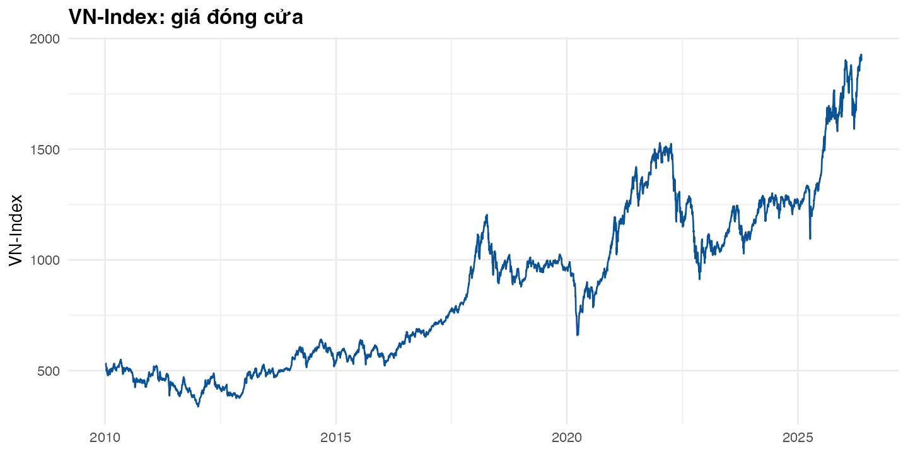

*Nguồn: Tính toán của tác giả từ dữ liệu của chương.*

### 3.1.4. Vai trò của dự báo volatility đối với nhà đầu tư Việt Nam

Dự báo volatility hỗ trợ điều chỉnh quy mô vị thế, hạn mức rủi ro và cường độ theo dõi danh mục. Volatility dự báo cao không khẳng định thị trường sẽ giảm; nó hàm ý biên độ lãi/lỗ có thể lớn hơn với cùng quy mô vị thế.

### 3.1.5. Vấn đề dữ liệu và thanh khoản tại Việt Nam

Thực nghiệm chỉ dùng OHLC ngày. Vì vậy, chương có thể dùng return đóng cửa và Garman--Klass, nhưng không thể tạo realized volatility từ giao dịch nội ngày. Mọi kết luận phải được đọc trong giới hạn này.

### 3.1.6. Mục tiêu của chương thực nghiệm

Chương trả lời bốn câu hỏi: chuỗi return có phù hợp với mô hình volatility động hay không; mô hình nào phù hợp trong mẫu; thứ hạng ngoài mẫu thay đổi thế nào theo horizon và loss function; và kết quả hàm ý gì cho quản trị rủi ro.

## 3.2. Tổng quan nghiên cứu về dự báo volatility

### 3.2.1. Nghiên cứu quốc tế về ARCH/GARCH

ARCH mô tả phương sai thay đổi theo thông tin quá khứ, còn GARCH bổ sung vai trò của phương sai có điều kiện trễ (Engle, 1982; Bollerslev, 1986). GARCH(1,1) vì vậy là benchmark phổ biến giữa khả năng mô tả cụm biến động và số lượng tham số.

### 3.2.2. Nghiên cứu quốc tế về EWMA

EWMA cập nhật phương sai bằng trọng số giảm dần cho quan sát cũ. RiskMetrics (1996) đưa nó thành benchmark phổ biến trong quản trị rủi ro. EWMA có thể cạnh tranh với GARCH trong một số bài toán forecast, nên không chỉ là công cụ minh họa (Alexander và Dakos, 2023).

### 3.2.3. Nghiên cứu về mô hình bất đối xứng

GJR-GARCH, EGARCH và APARCH cho phép volatility phản ứng khác nhau trước cú sốc âm và dương. Chúng cần được kiểm tra thực nghiệm thay vì mặc định là tốt hơn mô hình đối xứng.

### 3.2.4. Nghiên cứu về realized volatility và HAR

Realized volatility và HAR thường cần dữ liệu tần suất cao. Chúng không được ước lượng ở đây vì bộ dữ liệu chỉ có OHLC ngày; đây là giới hạn dữ liệu, không phải kết luận về sự phù hợp của HAR tại Việt Nam.

### 3.2.5. Nghiên cứu về volatility tại thị trường mới nổi

Các nghiên cứu về thị trường mới nổi thường kiểm tra đuôi dày, bất đối xứng và tính thay đổi theo thời gian. Bài học phương pháp là kết hợp fit trong mẫu, chẩn đoán phần dư và forecast ngoài mẫu.

### 3.2.6. Nghiên cứu về volatility tại Việt Nam

Nghiên cứu GARCH tại Việt Nam bắt đầu từ Vương Quân Hoàng (2004), người ước lượng hiệu ứng GARCH trên dãy lợi suất VN-Index giai đoạn 2000–2003 ngay từ khi thị trường mới vận hành. Tran (2011) và Vo và Nguyen (2011) tiếp tục dùng GARCH chuẩn để mô tả volatility clustering trên VN-Index, còn Hồ Thủy Tiên và cộng sự (2017) mở rộng sang so sánh nhiều đặc tả GARCH trên cùng chỉ số. Các nghiên cứu này thống nhất ở một điểm: chuỗi lợi suất cổ phiếu Việt Nam có phương sai thay đổi theo thời gian và tự tương quan trong bình phương lợi suất, đúng như ARCH–LM và Ljung–Box ở Bảng 3.5 của chương này cho thấy.

Về hình dạng phân phối, bằng chứng thực nghiệm tại Việt Nam cho thấy lợi suất VN-Index vi phạm rõ rệt giả định phân phối chuẩn. Vo và Nguyen (2011) và Hồ Thủy Tiên và cộng sự (2017) đo được hệ số kurtosis dao động trong khoảng 6,79–12,45, vượt xa mức 3 của phân phối chuẩn; kiểm định Jarque–Bera trong các nghiên cứu này đều bác bỏ giả thuyết chuẩn ở mức ý nghĩa cao. Skewness cũng không ổn định qua các giai đoạn thị trường: hệ số lệch âm phổ biến trong các chu kỳ suy thoái kéo dài, nhưng có thể chuyển sang lệch dương trong các đợt tăng nóng do dòng tiền đầu cơ ngắn hạn. Đặc điểm đuôi dày và lệch không ổn định là lý do các nghiên cứu sau này chuyển từ phân phối chuẩn sang Student-t và skewed-t; Nguyen và Tran (2024) áp dụng khung Markov-Switching GARCH với phân phối skewed-t để đồng thời nắm bắt độ dày đuôi và tính bất đối xứng khi ước lượng volatility trên thị trường Việt Nam. Ở phần đuôi cực đoan, Huynh và Nguyen (2019) chỉ ra rằng ngay cả Student-t cũng có thể đánh giá sai tổn thất tối đa tại các phân vị 99% và 99,5%, và đề xuất kết hợp GARCH với lý thuyết giá trị cực trị (GARCH–EVT) để cải thiện độ chính xác của VaR và Expected Shortfall trên các chỉ số ASEAN, trong đó có Việt Nam. Bằng chứng này phù hợp với thống kê mô tả và kiểm định phân phối chuẩn của mẫu VN-Index trong chương này (Bảng 3.3 và Hình 3.3): kurtosis 6,9670 và skewness -0,7818 nằm trong khoảng các nghiên cứu trước đã ghi nhận.

Ba đặc điểm thể chế và cấu trúc giao dịch của thị trường Việt Nam giúp giải thích các đặc tính phân phối trên và là căn cứ cho việc chọn mô hình ở Mục 3.6. Thứ nhất, biên độ dao động giá theo ngày (±7% trên HOSE, ±10% trên HNX) khiến lợi suất bị "chặn biên" khi xuất hiện cú sốc thông tin mạnh: phần biến động chưa phản ánh hết trong phiên bị dồn nén và có thể lan sang các phiên kế tiếp, làm tăng tính dai dẳng ước lượng được của phương sai có điều kiện. Đây là một phần lý do các đặc tả có khả năng nắm bắt phản ứng bất đối xứng và trễ dài như GJR-GARCH, EGARCH và APARCH được đưa vào so sánh ở chương này thay vì chỉ dùng GARCH đối xứng. Thứ hai, cơ cấu nhà đầu tư cá nhân chiếm tỷ trọng lớn trong giá trị giao dịch tạo điều kiện cho tâm lý bầy đàn và phản ứng thái quá trước tin tức, khiến phản ứng của volatility trước cú sốc dương và cú sốc âm không đối xứng theo hướng không cố định qua các giai đoạn — khác với giả định phản ứng bất đối xứng một chiều thường thấy ở thị trường phát triển. Thứ ba, thị trường Việt Nam trải qua nhiều điểm gãy cấu trúc gắn với các sự kiện lớn (khủng hoảng tài chính 2008, nợ xấu ngân hàng 2012, biến động thương mại quốc tế 2018, đại dịch COVID-19 2020–2021); Vo và Nguyen (2011) xác nhận các điểm gãy này bằng thuật toán ICSS, còn Nguyen và Tran (2024) mô hình hóa trực tiếp bằng regime switching. Một mô hình GARCH đơn chế độ ước lượng trên toàn mẫu — như cách tiếp cận chính của chương này — có thể đánh giá sai độ bền vững (persistence) nếu không phân tách chế độ; đây là giới hạn được nêu rõ ở Mục 3.10 và không được xem là đã giải quyết.

Về mặt bất đối xứng cụ thể, Phạm Tuấn Anh (2021) ước lượng đồng thời EGARCH(1,1) và TARCH(1,1) trên VN-Index giai đoạn 2000–2020 (4.931 quan sát) và chọn TARCH theo AIC/BIC; cả hai đặc tả đều cho thấy tin xấu làm volatility tăng mạnh hơn tin tốt. Tuy nhiên, lựa chọn mô hình trong nghiên cứu này — cũng như phần lớn nghiên cứu GARCH khác tại Việt Nam — dựa trên tiêu chí trong mẫu (AIC/BIC), không phải một cuộc thi dự báo ngoài mẫu theo horizon. Ở hướng ứng dụng VaR, Nguyễn Thành Đông (2025) so sánh mô phỏng lịch sử, GARCH và LSTM–GARCH trên danh mục 30 cổ phiếu VN30 (2018–2024) và báo cáo tỷ lệ vi phạm khác nhau giữa ba phương pháp, nhưng bài toán này là VaR danh mục, không phải dự báo mật độ có điều kiện của một chỉ số như VN-Index, và không công bố đầy đủ thiết kế rolling-window hay kiểm định thống kê về khác biệt độ chính xác.

Khoảng trống phương pháp xuyên suốt y văn Việt Nam, vì vậy, không nằm ở việc thiếu mô hình GARCH-type — các đặc tả đối xứng, bất đối xứng và có phân phối đuôi dày đều đã được áp dụng — mà nằm ở khâu đánh giá dự báo. Đa số nghiên cứu dừng lại ở lựa chọn mô hình trong mẫu bằng AIC/BIC hoặc ở phân tích sự kiện quanh các cú sốc cụ thể (COVID-19, giá dầu, tâm lý nhà đầu tư), trong khi so sánh dự báo ngoài mẫu theo horizon bằng QLIKE, kiểm định Diebold–Mariano và Model Confidence Set — công cụ chuẩn để phân biệt khác biệt có ý nghĩa thống kê giữa các mô hình cạnh tranh — còn hiếm. Do và Le (2026) là nghiên cứu gần nhất và có thiết kế gần với chương này nhất: so sánh hiệu năng GARCH-type theo horizon và theo chế độ thị trường trên một thị trường cận biên. Kết quả forecast ngoài mẫu ở Mục 3.9 của chương — không có mô hình nào thống trị mọi horizon và loss function, và phần lớn khác biệt không có ý nghĩa thống kê theo MCS ở Mục 3.9.6 — cùng hướng với phát hiện của Do và Le (2026) rằng thứ hạng mô hình phụ thuộc horizon và chế độ thị trường.

### 3.2.7. Khoảng trống nghiên cứu

Khoảng trống hướng dẫn của chương, dựa trên tổng quan ở Mục 3.2.6, là thiếu vắng một quy trình đánh giá dự báo ngoài mẫu minh bạch — kết hợp rolling-window, nhiều horizon, nhiều loss function và kiểm định khác biệt thống kê (DM, MCS) — cho volatility của VN-Index, trong bối cảnh phần lớn nghiên cứu trước chọn mô hình bằng tiêu chí trong mẫu. Chương không tuyên bố kết luận cho mọi cổ phiếu, mọi danh mục hay mọi giai đoạn thị trường Việt Nam; đây là minh họa quy trình trên một chỉ số, không phải một cuộc horserace toàn diện theo nghĩa mở rộng (nhiều tài sản, dữ liệu tần suất cao, GARCH-MIDAS hay FIGARCH) mà một số nghiên cứu quốc tế đã đề xuất.

## 3.3. Câu hỏi nghiên cứu và giả thuyết thực nghiệm

### 3.3.1. Câu hỏi về đặc điểm volatility của thị trường Việt Nam

Tỷ lệ sinh lời VN-Index có tự tương quan trong squared return và ARCH effect hay không?

### 3.3.2. Câu hỏi về hiệu quả của EWMA so với GARCH

EWMA có cạnh tranh được với GARCH-type ngoài mẫu hay không, và câu trả lời có thay đổi theo horizon không?

### 3.3.3. Câu hỏi về mô hình đối xứng và bất đối xứng

Cho phép phản ứng bất đối xứng có cải thiện fit hoặc forecast không?

### 3.3.4. Câu hỏi về vai trò của phân phối đuôi dày

Student-t và skewed-t có cải thiện information criteria so với phân phối chuẩn không?

### 3.3.5. Câu hỏi về tính ổn định của mô hình qua các giai đoạn thị trường

[Cần bổ sung output: câu hỏi này cần forecast đánh giá riêng theo regime được định nghĩa trước.]

### 3.3.6. Hệ thống giả thuyết nghiên cứu

- **H1:** Return VN-Index có volatility clustering và ARCH effect.
- **H2:** GARCH-type không nhất thiết vượt EWMA ở mọi horizon và loss function.
- **H3:** Mô hình bất đối xứng có thể cải thiện fit hoặc forecast.
- **H4:** Phân phối Student-t hoặc skewed-t có thể phù hợp hơn chuẩn.
- **H5:** [Cần bổ sung output] Thứ hạng mô hình có thể thay đổi theo regime.

## 3.4. Dữ liệu nghiên cứu

### 3.4.1. Lựa chọn chỉ số thị trường

Chuỗi giá VN-Index có 4.081 quan sát từ 05/01/2010 đến 20/05/2026. Sau khi tính log return, mẫu có 4.080 quan sát từ 06/01/2010 đến 20/05/2026.

### 3.4.2. Lựa chọn nhóm cổ phiếu đại diện

Chương không ước lượng theo nhóm cổ phiếu. Điều này giữ trọng tâm là rủi ro thị trường chung; kết quả không được suy rộng sang từng ngành hoặc từng mã.

### 3.4.3. Lựa chọn danh mục thực nghiệm

Không có danh mục nhiều tài sản trong thiết kế hiện hành. Một bài toán danh mục cần dữ liệu thành phần, quy tắc tái cân bằng và mô hình tương quan riêng.

### 3.4.4. Giai đoạn nghiên cứu

Cut-off là 20/05/2026. Pipeline thử cập nhật trực tuyến nhưng endpoint không phản hồi, nên sử dụng **archive fallback đã audit**; không được mô tả là dữ liệu cập nhật sau ngày này.

### 3.4.5. Tần suất dữ liệu

Dữ liệu ngày phù hợp với forecast 1, 5, 10 và 20 ngày, nhưng không phù hợp để ước lượng realized volatility nội ngày.

### 3.4.6. Nguồn dữ liệu

Nguồn trực tiếp là archive fallback đã được pipeline kiểm tra cấu trúc OHLC. Nguồn gốc nhà cung cấp trước archive chưa được xác minh độc lập, nên không gán tên nhà cung cấp cho chuỗi.

### 3.4.7. Xử lý dữ liệu

Log return được tính theo $r_t=100[\log(P_t)-\log(P_{t-1})]$, trong đó nhân 100 để thể hiện theo phần trăm.

**Bảng 3.1. Thông tin dữ liệu thực nghiệm**

| Nội dung | Thông tin |
|---|---|
| Tài sản | VN-Index |
| Tần suất | Ngày giao dịch |
| Giá | 05/01/2010--20/05/2026; 4.081 quan sát |
| Log return | 06/01/2010--20/05/2026; 4.080 quan sát |
| Dữ liệu đầu vào | OHLC; archive fallback đã audit |
| Cut-off | 20/05/2026 |

*Nguồn: Tính toán của tác giả từ `data/derived/data_manifest.csv`.*

**Bảng 3.2. Thiết kế thực nghiệm của chương**

| Thành phần | Thiết kế |
|---|---|
| Đối tượng | Log return ngày của VN-Index |
| Benchmark đơn giản | Historical, rolling và EWMA 0,94 |
| Mô hình chính | GARCH, GJR-GARCH, EGARCH và APARCH |
| Phân phối sai số | Normal, Student-t và skewed-t theo đặc tả |
| Fit trong mẫu | AIC, BIC và chẩn đoán phần dư chuẩn hóa |
| Forecast ngoài mẫu | RMSE, MAE, QLIKE tại h=1, 5, 10, 20 |

*Nguồn: Thiết kế của tác giả, đối chiếu với `MODEL_RUN_REPORT.md` và các bảng output của chương.*

## 3.5. Phân tích mô tả dữ liệu

### 3.5.1. Diễn biến giá tài sản

Hình 3.1 mô tả mức giá, không phải bằng chứng về tính dừng. Mô hình volatility được ước lượng trên return thay vì mức giá.

### 3.5.2. Diễn biến tỷ lệ sinh lời

Hình 3.2 so sánh histogram log return với đường chuẩn có cùng trung bình và độ lệch chuẩn. Sai khác ở hai đuôi cần được kiểm tra chính thức bằng Q--Q plot và thống kê mô tả.

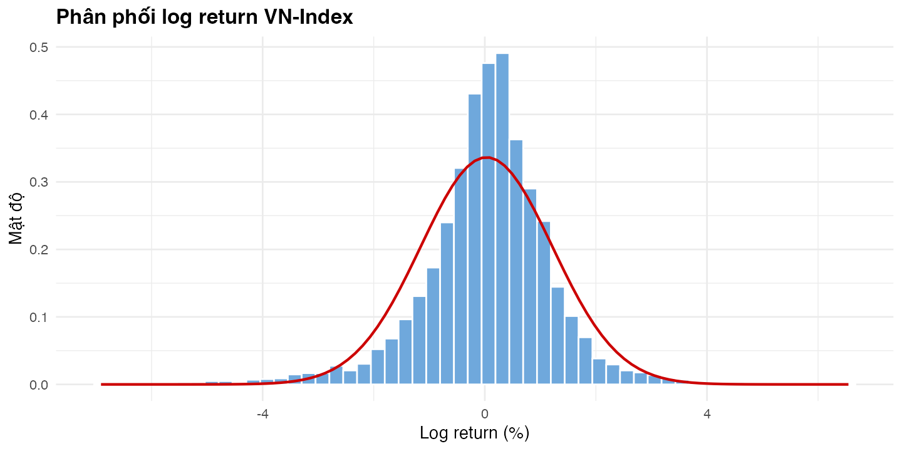

*Nguồn: Tính toán của tác giả.*

### 3.5.3. Thống kê mô tả tỷ lệ sinh lời

**Bảng 3.3. Thống kê mô tả log return VN-Index**

| Quan sát | Trung bình | Độ lệch chuẩn | Nhỏ nhất | Lớn nhất | Skewness | Kurtosis | JB p-value |
|---:|---:|---:|---:|---:|---:|---:|---:|
| 4.080 | 0,0312 | 1,1857 | -6,9102 | 6,5469 | -0,7818 | 6,9670 | <0,001 |

*Ghi chú: return tính theo %/ngày. Nguồn: Tính toán của tác giả từ `table_03_descriptive_statistics.csv`.*

Return trung bình ngày nhỏ so với độ lệch chuẩn. Skewness âm, kurtosis lớn hơn 3 và Jarque--Bera bác bỏ chuẩn tính; đây là lý do kiểm tra Student-t và skewed-t.

### 3.5.4. Kiểm định phân phối chuẩn

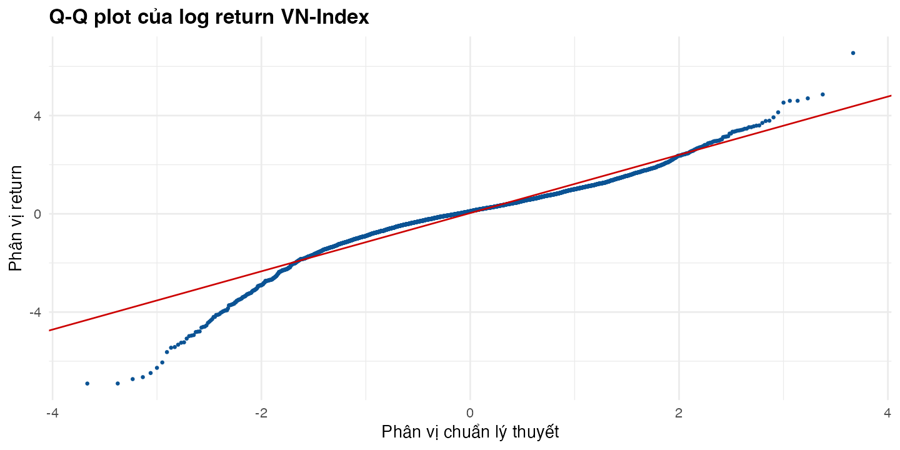

*Nguồn: Tính toán của tác giả.*

Nếu dữ liệu chuẩn, các điểm trong Hình 3.3 sẽ nằm gần đường tham chiếu. Độ lệch ở phần đuôi phù hợp với kết quả Jarque--Bera, nhưng hình chỉ là bằng chứng bổ trợ.

### 3.5.5. Kiểm định tính dừng

**Bảng 3.4. Kiểm định tính dừng**

| Chuỗi | ADF statistic | ADF p-value | KPSS statistic | KPSS p-value | Kết luận |
|---|---:|---:|---:|---:|---|
| Log price | -3,0916 | 0,1161 | 34,3242 | 0,0100 | Không dùng trực tiếp cho volatility |
| Log return | -16,2817 | 0,0100 | 0,1071 | 0,1000 | Phù hợp để mô hình hóa |

*Nguồn: Tính toán của tác giả từ `table_04_stationarity.csv`.*

ADF và KPSS cùng dẫn đến kết luận thực hành: dùng log return, không dùng mức log-price, làm đầu vào cho mô hình volatility.

### 3.5.6. Kiểm định tự tương quan

### 3.5.7. Kiểm định ARCH effect

**Bảng 3.5. Tự tương quan và ARCH effect ở độ trễ 12**

| Kiểm định | Thống kê | p-value | Diễn giải |
|---|---:|---:|---|
| Ljung--Box return | 54,1112 | <0,001 | Return còn cấu trúc tuyến tính |
| Ljung--Box squared return | 980,7487 | <0,001 | Squared return có phụ thuộc động |
| ARCH--LM | 473,1503 | <0,001 | Có ARCH effect |

*Nguồn: Tính toán của tác giả từ `table_05_arch_diagnostics.csv`.*

ARCH--LM bác bỏ phương sai không đổi. Điều này tạo cơ sở cho mô hình phương sai có điều kiện, nhưng chưa đủ để quyết định mô hình nào tốt nhất.

### 3.5.8. Nhận diện volatility clustering

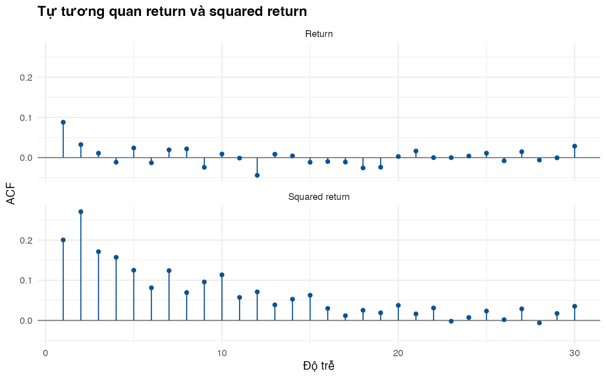

*Nguồn: Tính toán của tác giả.*

Hình 3.4 cho thấy squared return có tự tương quan rõ hơn return. Đây là minh họa trực quan của volatility clustering: các phiên biến động mạnh có xu hướng xuất hiện thành cụm.

## 3.6. Thiết kế mô hình thực nghiệm

### 3.6.1. Nhóm mô hình volatility truyền thống

Historical volatility là benchmark toàn mẫu. Rolling volatility dùng cửa sổ 20, 60, 120 và 252 ngày.

**Bảng 3.6. Historical volatility của VN-Index**

| Trung bình ngày | Volatility ngày | Volatility năm hóa | Quan sát |
|---:|---:|---:|---:|
| 0,0312 | 1,1857 | 18,8221 | 4.080 |

*Ghi chú: đơn vị là %. Nguồn: Tính toán của tác giả từ `table_06_historical_volatility.csv`.*

**Bảng 3.7. Tóm tắt rolling volatility**

| Cửa sổ | Trung bình | Trung vị | Phân vị 95% | Lớn nhất |
|---:|---:|---:|---:|---:|
| 20 | 1,0774 | 0,9765 | 2,0295 | 3,3619 |
| 60 | 1,1174 | 1,0999 | 1,8249 | 2,1963 |
| 120 | 1,1363 | 1,1615 | 1,6219 | 1,9020 |
| 252 | 1,1500 | 1,1599 | 1,4526 | 1,6549 |

*Ghi chú: đơn vị là %/ngày. Nguồn: Tính toán của tác giả từ `table_07_rolling_volatility.csv`.*

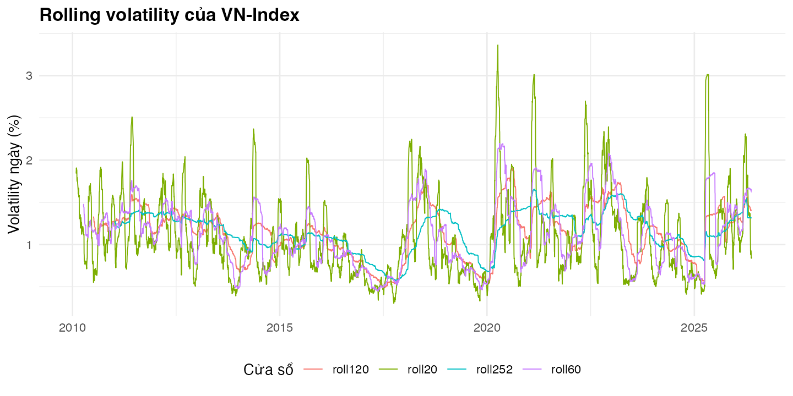

*Nguồn: Tính toán của tác giả.*

Cửa sổ ngắn phản ứng nhanh nhưng dao động mạnh hơn; cửa sổ dài mượt hơn nhưng có thể phản ứng chậm trước cú sốc.

### 3.6.2. Nhóm mô hình EWMA

EWMA được tính với $\lambda=0,90$, $0,94$ và $0,97$. Lambda càng cao, thông tin cũ mất trọng số càng chậm.

**Bảng 3.8. Tóm tắt EWMA volatility**

| Lambda | Trung bình | Trung vị | Phân vị 95% | Lớn nhất |
|---:|---:|---:|---:|---:|
| 0,90 | 1,0874 | 0,9997 | 2,0111 | 3,6347 |
| 0,94 | 1,1085 | 1,0514 | 1,8954 | 2,9788 |
| 0,97 | 1,1327 | 1,1076 | 1,7629 | 2,3625 |

*Ghi chú: đơn vị là %/ngày. Nguồn: Tính toán của tác giả từ `table_08_ewma_volatility.csv`.*

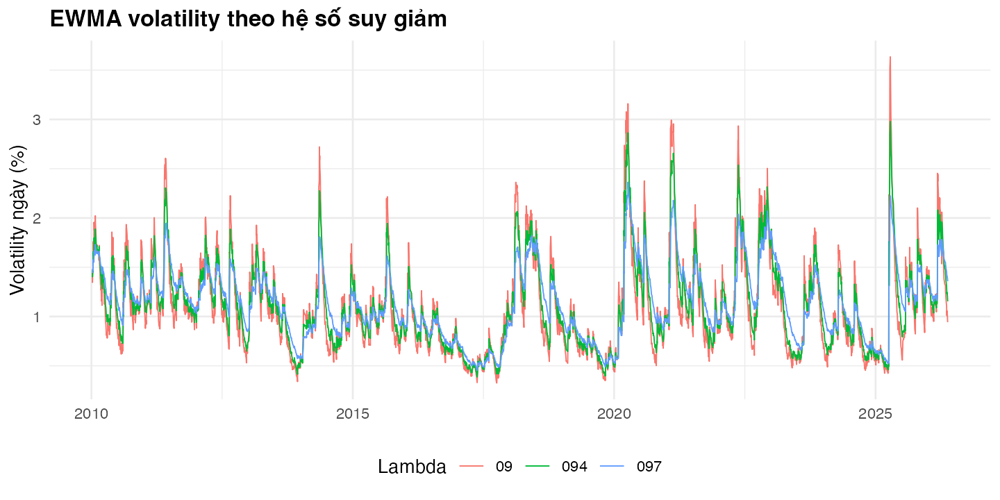

*Nguồn: Tính toán của tác giả.*

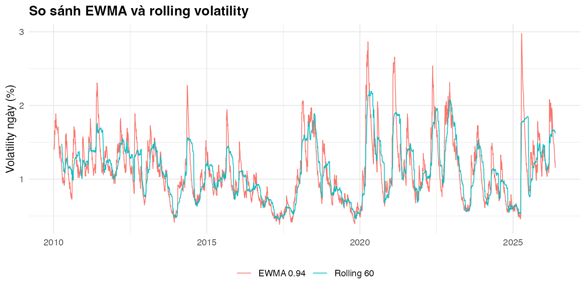

*Nguồn: Tính toán của tác giả.*

EWMA 0,94 được giữ làm benchmark RiskMetrics trong phần forecast. Hai hình trên cho thấy EWMA và rolling volatility ghi nhớ cú sốc theo cách khác nhau.

### 3.6.3. Nhóm mô hình GARCH đối xứng

GARCH-normal và GARCH-Student-t là benchmark đối xứng. Cả hai dùng ARMA(2,1) cho phương trình trung bình, được chọn theo BIC thấp nhất trong nhóm ứng viên đạt Ljung--Box p-value từ 0,05 trở lên.

**Bảng 3.8b. Ứng viên ARMA đạt chẩn đoán phần dư**

| ARMA(p,q) | AIC | BIC | Ljung--Box p-value |
|---|---:|---:|---:|
| (1,2) | 2,8849 | 2,8973 | 0,0558 |
| (2,1) | 2,8849 | 2,8973 | 0,0537 |
| (3,1) | 2,8853 | 2,8992 | 0,0521 |
| (3,2) | 2,8854 | 2,9008 | 0,0707 |

*Ghi chú: ARMA(2,1) có BIC nhỏ nhất trong nhóm đạt điều kiện. Nguồn: Tính toán của tác giả từ `table_08b_mean_model_selection.csv`.*

### 3.6.4. Nhóm mô hình GARCH bất đối xứng

GJR-GARCH, EGARCH và APARCH kiểm tra phản ứng khác nhau của volatility trước cú sốc âm và dương. Chúng là đặc tả thay thế, không phải mặc định tốt hơn GARCH đối xứng.

### 3.6.5. Nhóm mô hình có phân phối đuôi dày

Student-t và skewed-t được đưa vào vì Bảng 3.3 cho thấy return không gần chuẩn. Shape liên quan độ dày đuôi và skew cho phép phân phối lệch; các tham số này phải được đọc cùng fit, chẩn đoán và forecast.

### 3.6.6. Nhóm mô hình realized volatility nếu dữ liệu cho phép

HAR không được ước lượng do không có dữ liệu nội ngày. Garman--Klass từ OHLC chỉ là proxy bổ sung, không phải realized volatility tần suất cao.

**Bảng 3.13. Vai trò của các thước đo volatility trong chương**

| Thước đo | Dữ liệu cần có | Vai trò |
|---|---|---|
| Historical | Close | Benchmark |
| Rolling | Close | Dynamic benchmark |
| EWMA | Close | RiskMetrics benchmark |
| GARCH-type | Close | Mô hình chính |
| Garman--Klass | OHLC | Proxy bổ sung |

*Nguồn: Tính toán của tác giả từ `table_13_volatility_measure_map.csv`.*

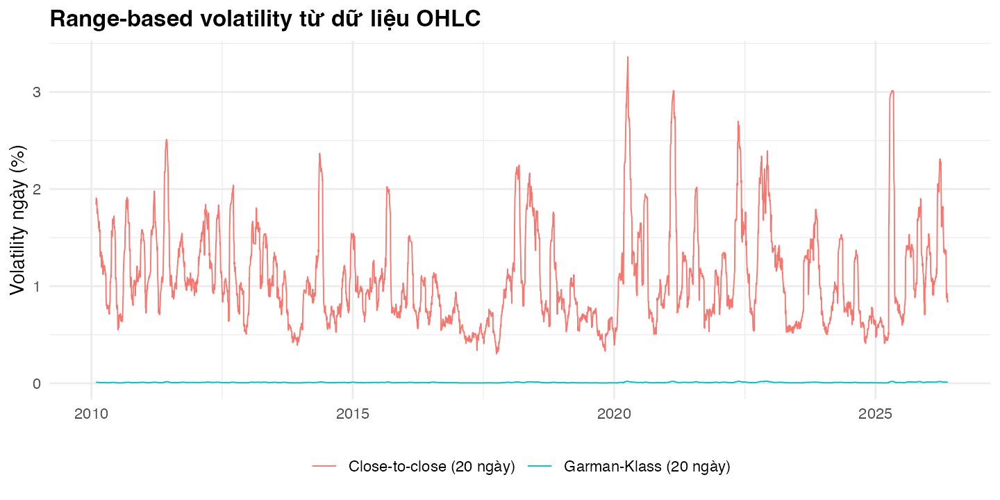

*Nguồn: Tính toán của tác giả.*

Garman--Klass khai thác dao động trong phiên từ OHLC, nhưng không thay thế realized volatility nội ngày hoặc mô hình phương sai có điều kiện.

### 3.6.7. Tiêu chí lựa chọn mô hình đưa vào so sánh

So sánh mô hình theo ba lớp: AIC/BIC trong mẫu, chẩn đoán phần dư chuẩn hóa và RMSE/MAE/QLIKE ngoài mẫu.

**Bảng 3.9. Information criteria của các mô hình GARCH-type**

| Mô hình | AIC | BIC |
|---|---:|---:|
| GARCH-normal | 2,9812 | 2,9920 |
| GARCH-Student-t | 2,8849 | 2,8973 |
| GJR-GARCH-Student-t | 2,8777 | 2,8917 |
| GJR-GARCH-skewed-t | 2,8664 | 2,8819 |
| EGARCH-Student-t | 2,8712 | 2,8852 |
| EGARCH-skewed-t | **2,8586** | **2,8741** |
| APARCH-Student-t | 2,8735 | 2,8890 |
| APARCH-skewed-t | 2,8607 | 2,8777 |

*Nguồn: Tính toán của tác giả từ `table_09_garch_information_criteria.csv`.*

EGARCH-skewed-t có AIC/BIC thấp nhất; APARCH-skewed-t đứng thứ hai theo BIC. Đây chỉ là kết quả fit trong mẫu.

## 3.7. Thiết kế dự báo và đánh giá mô hình

### 3.7.1. Mẫu ước lượng và mẫu kiểm định

Mỗi forecast origin dùng 1.250 ngày giao dịch gần nhất để ước lượng. Dữ liệu sau origin không được dùng ở bước ước lượng đó.

### 3.7.2. Rolling-window design

Rolling window giúp forecast tập trung vào thông tin gần thay vì gán trọng số như nhau cho toàn bộ lịch sử.

### 3.7.3. Expanding-window design

[Cần bổ sung output: pipeline hiện hành không có expanding-window forecast.]

### 3.7.4. Forecast horizon

Horizon gồm 1, 5, 10 và 20 ngày. Kết quả tốt ở một ngày không được mặc định áp cho một tháng giao dịch.

### 3.7.5. Benchmark volatility

Proxy volatility thực tế tại horizon $h$ là $\widetilde{\sigma}_{t,h}^{2}=\sum_{j=1}^{h}r_{t+j}^{2}$. Đây là proxy có nhiễu, không phải realized volatility nội ngày.

### 3.7.6. Tiêu chí đánh giá forecast accuracy

RMSE phạt mạnh sai số lớn, MAE là sai số tuyệt đối bình quân, còn QLIKE là loss dương cho forecast variance. Thứ hạng có thể khác nhau giữa các tiêu chí.

### 3.7.7. Kiểm định khác biệt giữa các mô hình

[Cần bổ sung output: chưa có Diebold--Mariano hoặc kiểm định tương đương.]

**Bảng 3.14. Thiết kế forecast exercise**

| Thành phần | Thiết lập |
|---|---|
| Cửa sổ ước lượng | 1.250 ngày giao dịch |
| Horizon | 1, 5, 10, 20 ngày |
| Refit | Mỗi 20 ngày giao dịch |
| Forecast origins tối đa | 50 |
| Proxy thực tế | Tổng squared returns tương lai |
| Loss functions | RMSE, MAE, QLIKE |

*Nguồn: Tính toán của tác giả từ `table_14_forecast_design.csv`.*

## 3.8. Kết quả thực nghiệm in-sample

### 3.8.1. Kết quả ước lượng mô hình EWMA

EWMA không được ước lượng bằng maximum likelihood như GARCH. Bảng 3.8 cho thấy lambda quyết định độ nhạy; EWMA 0,94 là benchmark ngoài mẫu, không phải lựa chọn mặc định.

### 3.8.2. Kết quả ước lượng GARCH cơ bản

Trong GARCH đối xứng, $\alpha_1$ mô tả phản ứng trước cú sốc mới và $\beta_1$ phản ánh tính kéo dài của volatility quá khứ. Persistence cao nghĩa là cú sốc không biến mất ngay.

### 3.8.3. Kết quả ước lượng mô hình bất đối xứng

Các hệ số gamma trong output hiện hành dương. Điều này ủng hộ việc cho phép phản ứng theo dấu cú sốc, nhưng không cho phép so sánh cơ học độ lớn gamma giữa GJR, EGARCH và APARCH vì các mô hình có dạng khác nhau.

### 3.8.4. Kết quả với phân phối Student-t và skewed-t

Các đặc tả Student-t và skewed-t có information criteria thấp hơn GARCH-normal. Kết quả phù hợp với đuôi dày và độ lệch trong mô tả dữ liệu, nhưng không chứng minh skewed-t sẽ tốt nhất ngoài mẫu ở mọi horizon.

**Bảng 3.10. Các hệ số phương sai có điều kiện được chọn lọc**

| Mô hình | alpha1 | beta1 | gamma1 | Shape | Skew | Delta |
|---|---:|---:|---:|---:|---:|---:|
| GARCH-normal | 0,1413 | 0,8130 | — | — | — | — |
| GARCH-Student-t | 0,1632 | 0,8053 | — | 5,1679 | — | — |
| GJR-GARCH-Student-t | 0,0826 | 0,7847 | 0,1538 | 5,2001 | — | — |
| GJR-GARCH-skewed-t | 0,0908 | 0,7985 | 0,1191 | 5,6825 | 0,8517 | — |
| EGARCH-Student-t | -0,0938 | 0,9407 | 0,2741 | 5,3692 | — | — |
| EGARCH-skewed-t | -0,0910 | 0,9447 | 0,2600 | 5,8054 | 0,8491 | — |
| APARCH-Student-t | 0,1572 | 0,8162 | 0,3793 | 5,2864 | — | 1,1971 |
| APARCH-skewed-t | 0,1483 | 0,8293 | 0,3823 | 5,7116 | 0,8484 | 1,1996 |

*Ghi chú: ý nghĩa chính xác của alpha1, beta1 và gamma1 phụ thuộc vào dạng phương trình phương sai; không so sánh cơ học giữa các họ mô hình. Bảng chỉ rút gọn các tham số phương sai và phân phối; toàn bộ hệ số ARMA và sai số chuẩn nằm trong `output/estimates/garch_coefficients.csv`. Nguồn: Tính toán của tác giả từ `table_10_garch_coefficients.csv`.*

### 3.8.5. So sánh information criteria

Bảng 3.9 chọn EGARCH-skewed-t là đặc tả in-sample ưu tiên. Kết luận chỉ được dùng sau khi kiểm tra chẩn đoán ở mục tiếp theo.

### 3.8.6. Chẩn đoán phần dư chuẩn hóa

**Bảng 3.12. Chẩn đoán phần dư chuẩn hóa (p-value)**

| Mô hình | Ljung--Box z | Ljung--Box z² | ARCH--LM z |
|---|---:|---:|---:|
| GARCH-normal | 0,0788 | 0,6124 | 0,5961 |
| GARCH-Student-t | 0,0537 | 0,6989 | 0,6925 |
| GJR-GARCH-Student-t | 0,1276 | 0,7790 | 0,7737 |
| GJR-GARCH-skewed-t | **0,0115** | 0,7929 | 0,7875 |
| EGARCH-Student-t | 0,1771 | 0,8843 | 0,8846 |
| EGARCH-skewed-t | 0,0679 | 0,8784 | 0,8782 |
| APARCH-Student-t | 0,1426 | 0,7001 | 0,7060 |
| APARCH-skewed-t | 0,0660 | 0,6439 | 0,6482 |

*Nguồn: Tính toán của tác giả từ `table_12_garch_diagnostics.csv`.*

Không mô hình nào còn ARCH effect trong squared standardized residuals. GJR-GARCH-skewed-t còn tự tương quan trong standardized residuals ở mức 5%, nên không được chọn làm đặc tả ưu tiên dù có MAE tốt ở h=1.

### 3.8.7. Diễn giải ý nghĩa kinh tế của các tham số

**Bảng 3.11. Persistence và half-life của volatility**

| Mô hình | Persistence | Half-life (ngày) |
|---|---:|---:|
| GARCH-normal | 0,9543 | 14,81 |
| GARCH-Student-t | 0,9684 | 21,61 |
| GJR-GARCH-Student-t | 0,9443 | 12,09 |
| GJR-GARCH-skewed-t | 0,9488 | 13,19 |
| EGARCH-Student-t | 0,9407 | 11,34 |
| EGARCH-skewed-t | 0,9447 | 12,18 |
| APARCH-Student-t | 1,1631 | Không áp dụng |
| APARCH-skewed-t | 1,1688 | Không áp dụng |

*Ghi chú: persistence APARCH là proxy trong mô hình power-volatility, không diễn giải như GARCH thông thường. Nguồn: Tính toán của tác giả từ `table_11_garch_persistence.csv`.*

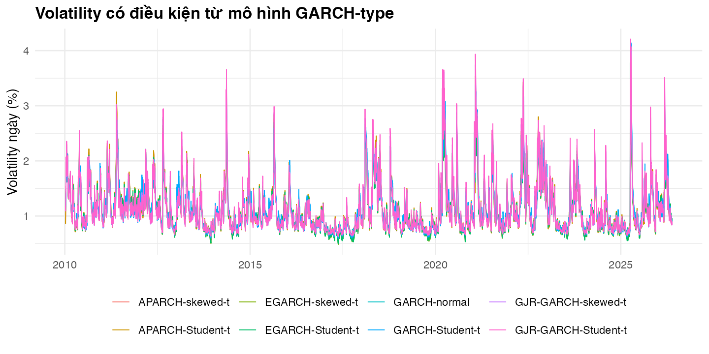

*Nguồn: Tính toán của tác giả.*

Hình 3.8 giúp nhận diện các giai đoạn các mô hình cùng báo volatility cao, không dùng để xếp hạng forecast.

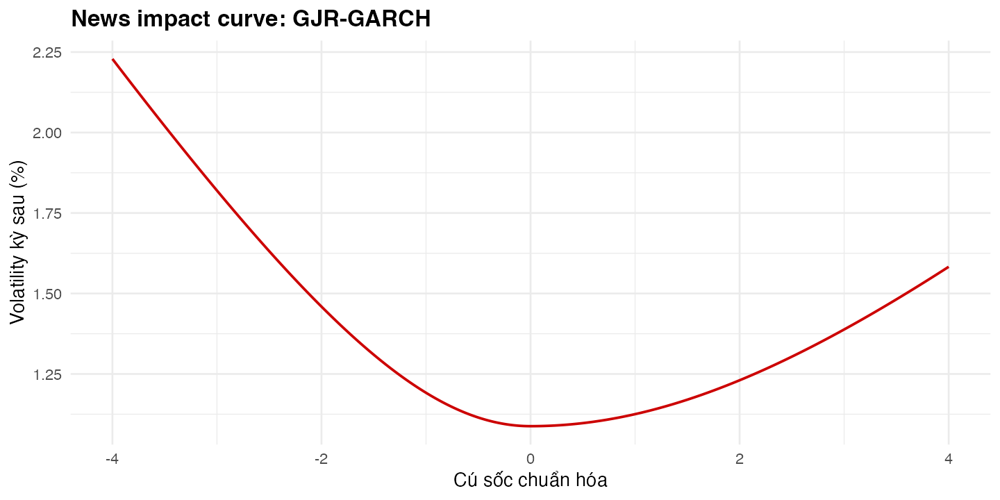

*Nguồn: Tính toán của tác giả.*

Hình 3.9 minh họa cơ chế bất đối xứng của GJR-GARCH, không phải kiểm định riêng theo regime.

## 3.9. Kết quả dự báo out-of-sample

### 3.9.1. So sánh dự báo volatility theo MSE

Pipeline báo cáo RMSE thay MSE. Hai tiêu chí có cùng thứ hạng; RMSE có đơn vị dễ diễn giải hơn.

**Bảng 3.15. RMSE theo horizon**

| Mô hình | h=1 | h=5 | h=10 | h=20 |
|---|---:|---:|---:|---:|
| APARCH-Student-t | 6,1146 | 8,9749 | 14,8068 | 32,6513 |
| APARCH-skewed-t | 6,1460 | 8,9968 | 14,4506 | **31,9665** |
| EGARCH-Student-t | 6,1488 | **8,8504** | 14,6629 | 33,0322 |
| EGARCH-skewed-t | 6,1842 | 8,9082 | 14,4907 | 32,6263 |
| EWMA 0,94 | 6,5104 | 10,9717 | 18,5393 | 41,1566 |
| GARCH-Student-t | 6,3615 | 10,8314 | 17,5398 | 37,1463 |
| GARCH-normal | 6,3338 | 9,9755 | 15,3661 | 32,9865 |
| GJR-GARCH-Student-t | **6,1064** | 9,0060 | 14,7149 | 32,4167 |
| GJR-GARCH-skewed-t | 6,1606 | 8,9927 | **14,4409** | 32,2828 |
| Rolling 120 | 6,3690 | 9,6173 | 16,3565 | 36,3074 |
| Rolling 60 | 6,3988 | 10,3823 | 17,6960 | 39,7640 |

*Nguồn: Tính toán của tác giả từ `table_15_forecast_rmse.csv`.*

### 3.9.2. So sánh dự báo volatility theo MAE

**Bảng 3.16. MAE theo horizon**

| Mô hình | h=1 | h=5 | h=10 | h=20 |
|---|---:|---:|---:|---:|
| APARCH-Student-t | 1,8958 | 5,3786 | 10,3547 | 21,3818 |
| APARCH-skewed-t | 1,9020 | 5,3528 | 10,2709 | 20,9584 |
| EGARCH-Student-t | 1,9037 | 5,1380 | 9,9207 | 20,8571 |
| EGARCH-skewed-t | 1,9084 | **5,0767** | **9,7405** | **20,6195** |
| EWMA 0,94 | 2,1490 | 5,7487 | 10,9859 | 25,1809 |
| GARCH-Student-t | 2,0500 | 6,3312 | 11,9416 | 25,5285 |
| GARCH-normal | 2,0029 | 5,6445 | 10,2738 | 21,1082 |
| GJR-GARCH-Student-t | 1,8502 | 5,5176 | 10,6782 | 22,3974 |
| GJR-GARCH-skewed-t | **1,8487** | 5,2614 | 10,0548 | 21,3425 |
| Rolling 120 | 2,0854 | 5,7464 | 10,8387 | 23,8843 |
| Rolling 60 | 2,0418 | 6,1531 | 11,5097 | 27,1109 |

*Nguồn: Tính toán của tác giả từ `table_16_forecast_mae.csv`.*

### 3.9.3. So sánh dự báo volatility theo QLIKE

**Bảng 3.17. QLIKE theo horizon**

| Mô hình | h=1 | h=5 | h=10 | h=20 |
|---|---:|---:|---:|---:|
| APARCH-Student-t | 1,5380 | 0,3913 | 0,3914 | 0,4196 |
| APARCH-skewed-t | 1,5520 | 0,3833 | 0,3718 | 0,4139 |
| EGARCH-Student-t | 1,5781 | 0,3739 | 0,3754 | 0,4522 |
| EGARCH-skewed-t | 1,5933 | **0,3632** | 0,3597 | 0,4530 |
| EWMA 0,94 | 2,0286 | 0,4216 | 0,4026 | 0,9090 |
| GARCH-Student-t | 1,7456 | 0,4474 | 0,3956 | 0,4296 |
| GARCH-normal | 1,7440 | 0,4094 | **0,3504** | **0,4012** |
| GJR-GARCH-Student-t | **1,5293** | 0,4158 | 0,4031 | 0,4069 |
| GJR-GARCH-skewed-t | 1,5522 | 0,3971 | 0,3781 | 0,4132 |
| Rolling 120 | 1,9595 | 0,4931 | 0,4673 | 0,8203 |
| Rolling 60 | 1,9078 | 0,4827 | 0,5203 | 0,9657 |

*Nguồn: Tính toán của tác giả từ `table_17_forecast_qlike.csv`.*

### 3.9.4. Kết quả Mincer--Zarnowitz regression

Hồi quy Mincer--Zarnowitz ước lượng $\widetilde{\sigma}_{t,h}^{2}=a+b\,\hat{\sigma}_{t,h}^{2}+\varepsilon_t$ cho từng cặp mô hình--horizon, với giả thuyết hiệu quả dự báo là $a=0$ và $b=1$ đồng thời. $R^2$ toàn bộ mô hình--horizon nằm trong khoảng 0,0000--0,2377, phản ánh proxy squared-return rất nhiễu chứ không phải mô hình vô dụng.

**Bảng 3.19. Kiểm định Mincer--Zarnowitz theo horizon (kiểm định đồng thời $a=0,\,b=1$)**

| Horizon | Số mô hình bác bỏ ở 5% | Mô hình bác bỏ |
|---:|---:|---|
| 1 | 0/11 | không có |
| 5 | 4/11 | EWMA 0,94; GARCH-normal; GARCH-Student-t; Rolling 60 |
| 10 | 3/11 | EWMA 0,94; GARCH-Student-t; Rolling 60 |
| 20 | 4/11 | EWMA 0,94; GARCH-Student-t; Rolling 60; Rolling 120 |

*Ghi chú: bác bỏ nghĩa là joint F-test cho $a=0,\,b=1$ có p-value < 0,05. Toàn bộ hệ số, $R^2$ và p-value từng mô hình--horizon nằm trong `output/tables/table_19_mincer_zarnowitz.csv`. Nguồn: Tính toán của tác giả.*

Ở h=1, không mô hình nào bị bác bỏ giả thuyết hiệu quả dự báo — phù hợp với proxy 1 ngày ít nhiễu hơn proxy đa ngày. Từ h=5 trở đi, EWMA 0,94 và GARCH-Student-t bị bác bỏ nhất quán, cho thấy hai mô hình này có độ chệch hệ thống (intercept dương lớn, slope nhỏ hơn 1 đáng kể) khi horizon dài hơn. Các đặc tả bất đối xứng (GJR, EGARCH, APARCH) không bị bác bỏ ở bất kỳ horizon nào.

### 3.9.5. Kết quả Diebold--Mariano test

Với mỗi horizon, mô hình có RMSE thấp nhất ở Bảng 3.15 được dùng làm mô hình tham chiếu; DM test so sánh loss bình phương của từng mô hình còn lại với mô hình tham chiếu đó.

**Bảng 3.20. Diebold--Mariano test so với mô hình RMSE thấp nhất mỗi horizon**

| Horizon | Mô hình tham chiếu | Số cặp có p<0,10 | Số cặp có p<0,05 |
|---:|---|---:|---:|
| 1 | GJR-GARCH-Student-t | 1/10 (APARCH-skewed-t) | 0/10 |
| 5 | EGARCH-Student-t | 3/10 (EWMA 0,94; GARCH-normal; EGARCH-skewed-t) | 1/10 (EGARCH-skewed-t) |
| 10 | GJR-GARCH-skewed-t | 1/10 (EWMA 0,94) | 0/10 |
| 20 | APARCH-skewed-t | 1/10 (Rolling 60) | 0/10 |

*Ghi chú: `h` trong `dm.test` khớp horizon dự báo; loss là sai số bình phương. Toàn bộ thống kê DM và p-value từng cặp nằm trong `output/tables/table_20_diebold_mariano.csv`. Nguồn: Tính toán của tác giả.*

Phần lớn cặp so sánh không bác bỏ giả thuyết độ chính xác dự báo bằng nhau, kể cả ở 10%. Đây là bằng chứng thống kê cho nhận định ở Bảng 3.18: khoảng cách RMSE giữa các mô hình dẫn đầu và nhóm theo sau phần lớn không có ý nghĩa thống kê với 50 forecast origin.

### 3.9.6. Kết quả Model Confidence Set

Model Confidence Set (Hansen, Lunde và Nason, 2011) được ước lượng trên loss bình phương, thống kê TR, $\alpha=0,10$, 2.000 lần bootstrap khối.

**Bảng 3.21. Model Confidence Set 90% theo horizon**

| Horizon | Số mô hình trong MCS 90% | Mô hình bị loại |
|---:|---:|---|
| 1 | 11/11 | không có |
| 5 | 11/11 | không có |
| 10 | 11/11 | không có |
| 20 | 10/11 | Rolling 60 |

*Ghi chú: MCS p-value cuối cùng và thành phần tập hợp nằm trong `output/tables/table_21_model_confidence_set.csv`. Nguồn: Tính toán của tác giả từ `MCS::MCSprocedure`.*

MCS ở mức tin cậy 90% giữ lại gần như toàn bộ 11 mô hình ở mọi horizon; chỉ Rolling 60 bị loại ở h=20. Kết quả này nhất quán với DM test ở Mục 3.9.5: với 50 forecast origin, dữ liệu không đủ mạnh để phân biệt thống kê phần lớn mô hình GARCH-type, EWMA và rolling. Xếp hạng ở Bảng 3.15--3.18 nên được đọc như thứ hạng điểm, không phải khác biệt có ý nghĩa thống kê giữa các mô hình còn lại trong MCS.

### 3.9.7. Xếp hạng mô hình theo từng tiêu chí

**Bảng 3.18. Mô hình tốt nhất theo metric và horizon**

| Horizon | MAE | QLIKE | RMSE |
|---:|---|---|---|
| 1 ngày | GJR-GARCH-skewed-t | GJR-GARCH-Student-t | GJR-GARCH-Student-t |
| 5 ngày | EGARCH-skewed-t | EGARCH-skewed-t | EGARCH-Student-t |
| 10 ngày | EGARCH-skewed-t | GARCH-normal | GJR-GARCH-skewed-t |
| 20 ngày | EGARCH-skewed-t | GARCH-normal | APARCH-skewed-t |

*Nguồn: Tính toán của tác giả từ `table_18_best_forecast_models.csv`.*

Không có mô hình thống trị mọi horizon và metric. GJR-GARCH-Student-t nổi bật ở h=1 theo RMSE/QLIKE; EGARCH-skewed-t thường dẫn đầu MAE từ 5 đến 20 ngày; GARCH-normal có QLIKE thấp nhất ở h=10 và h=20. GJR-GARCH-skewed-t cần được dùng thận trọng do chẩn đoán residual.

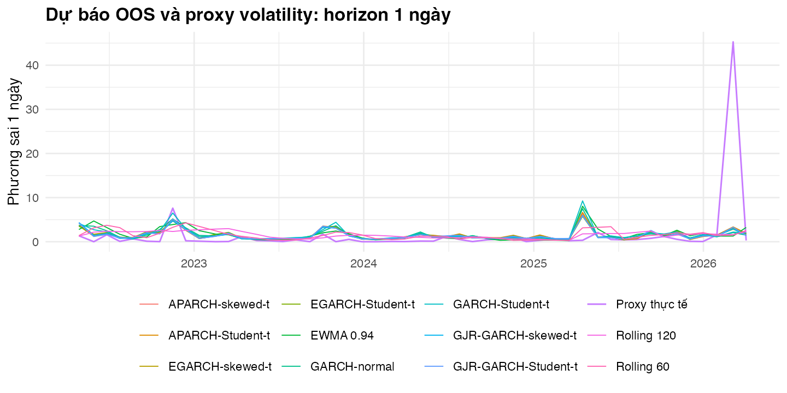

*Nguồn: Tính toán của tác giả.*

Proxy squared return rất nhiễu, nên Hình 3.10 chỉ bổ sung trực quan cho các bảng loss.

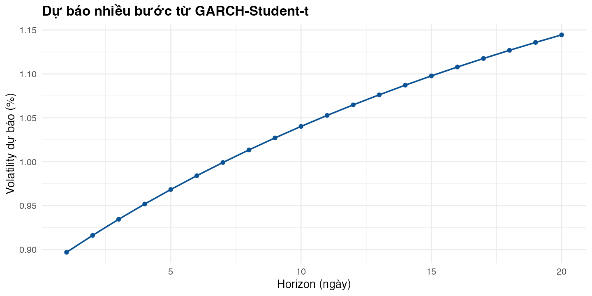

*Nguồn: Tính toán của tác giả.*

Khi không có thông tin mới, forecast nhiều bước tiến dần về mức dài hạn của mô hình; đây không phải dự báo hướng giá.

## 3.10. Phân tích theo giai đoạn thị trường

Phân tích regime cần quy tắc chia giai đoạn được xác định trước, forecast riêng theo từng giai đoạn và số origin đủ lớn. Output hiện hành chưa có bước này.

### 3.10.1. Giai đoạn thị trường ổn định

[Cần bổ sung output: cần quy tắc xác định và metric forecast riêng.]

### 3.10.2. Giai đoạn khủng hoảng hoặc biến động cao

[Cần bổ sung output: cần quy tắc xác định và metric forecast riêng.]

### 3.10.3. Giai đoạn COVID-19

[Cần bổ sung output: không suy diễn kết quả COVID-19 từ forecast toàn mẫu.]

### 3.10.4. Giai đoạn thị trường giảm mạnh

[Cần bổ sung output: cần tiêu chí định lượng cho thị trường giảm mạnh.]

### 3.10.5. Giai đoạn phục hồi

[Cần bổ sung output: cần tiêu chí định lượng cho phục hồi.]

### 3.10.6. So sánh tính ổn định của mô hình qua các giai đoạn

[Cần bổ sung output: chưa có bảng xếp hạng theo regime.]

### 3.10.7. Hàm ý về regime dependence trong dự báo volatility

Không thể kết luận về regime dependence từ output hiện hành.

## 3.11. Kiểm định độ bền

### 3.11.1. Thay đổi cửa sổ ước lượng

[Cần bổ sung output: forecast hiện hành chỉ dùng cửa sổ 1.250 ngày.]

### 3.11.2. Thay đổi forecast horizon

Bảng 3.15--3.18 là kiểm tra độ nhạy theo horizon 1, 5, 10 và 20 ngày. Thứ hạng thay đổi, nên không lấy kết quả h=1 áp cho mọi kỳ hạn.

### 3.11.3. Thay đổi tài sản hoặc danh mục

[Cần bổ sung output: chỉ có VN-Index, không có cổ phiếu riêng lẻ hoặc danh mục.]

### 3.11.4. Thay đổi phân phối sai số

Đây là kiểm tra đã có: normal, Student-t và skewed-t. Kết quả in-sample ủng hộ đuôi dày, nhưng forecast vẫn phụ thuộc metric và horizon.

### 3.11.5. Loại bỏ outliers

[Cần bổ sung output: chưa có ước lượng sau loại hoặc winsorize outliers.]

### 3.11.6. Phân tích theo nhóm ngành

[Cần bổ sung output: không có dữ liệu nhóm ngành.]

### 3.11.7. Phân tích theo mức thanh khoản

[Cần bổ sung output: không có biến thanh khoản để phân nhóm.]

## 3.12. Kết luận thực nghiệm về volatility tại Việt Nam

### 3.12.1. Mô hình tốt nhất theo in-sample fit

EGARCH-skewed-t có AIC/BIC thấp nhất; APARCH-skewed-t đứng thứ hai theo BIC. Đây là kết luận về fit trong mẫu.

### 3.12.2. Mô hình tốt nhất theo out-of-sample forecast

Không có mô hình tốt nhất cho mọi horizon và loss. GJR-GARCH-Student-t nổi bật ở h=1 theo RMSE/QLIKE; EGARCH-skewed-t có MAE thấp ở h=5, h=10 và h=20; GARCH-normal có QLIKE thấp nhất ở h=10 và h=20.

### 3.12.3. Mô hình ổn định nhất qua các giai đoạn

[Cần bổ sung output: chưa có đánh giá theo regime.]

### 3.12.4. Mô hình phù hợp nhất cho ứng dụng thực tiễn

Lựa chọn phụ thuộc mục tiêu. Nếu ưu tiên variance forecast rất ngắn hạn, GJR-GARCH-Student-t là ứng viên đáng xem xét; nếu ưu tiên MAE từ một đến bốn tuần, EGARCH-skewed-t đáng chú ý; nếu ưu tiên QLIKE ở h=10--20, GARCH-normal cho kết quả tốt trong bài toán này. Mọi lựa chọn phải đi kèm chẩn đoán phần dư và giới hạn của proxy volatility.

### 3.12.5. Hàm ý cho chương VaR/ES tiếp theo

Volatility forecast là đầu vào, không phải toàn bộ mô hình rủi ro. Chương 4 trình bày phương pháp VaR và Expected Shortfall; Chương 5 sẽ áp dụng các phương pháp đó trên thị trường Việt Nam.

## Tài liệu tham khảo

Danh mục nguồn đã xác minh của chương được quản lý tại `references/bibliography.bib`. Các phần gắn `[Missing Citation]` không được xem là luận điểm đã có nguồn.
